My site had been wearing the same outfit for years. It was a perfectly nice outfit (the Cayman theme for Jekyll, with a blue-to-green gradient) but it didn't really look like _me_.

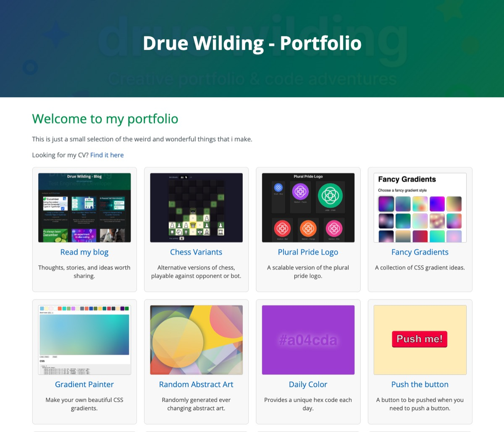

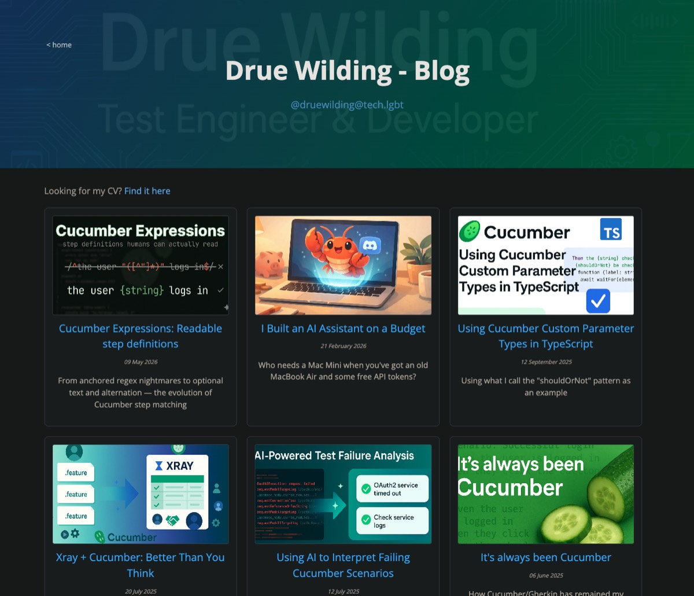

Every card was the same size and the same grey. A deep dive into Cucumber had exactly the same weight as a crochet ball for my dog. Dark mode was done by a script called DarkReader, which recolours the page _after_ it has loaded, so you'd get a flash of white and some slightly odd colours.

So i spent an evening redesigning it with [Claude Code](https://claude.com/claude-code). I said what i wanted (and, mostly, what i _didn't_ want), Claude built it, and i nitpicked until i was happy. This is how it went.

## The big idea: a new colour every day

A while ago i made [Daily Color](/daily-color/), which turns today's date into a hex code. Every day gets its own colour, and everyone in the world sees the same one.

What if the whole site wore that colour? (The picture at the top of this post is the homepage on six different days.)

The catch is that the daily colour can be _anything_. Some days it's a pale peach, some days it's nearly black, and some days it's a neon green that could guide aircraft in to land. Whatever the colour, the text still has to be readable.

Before touching the site, we built a little explorer page to try the idea against every day of the year:

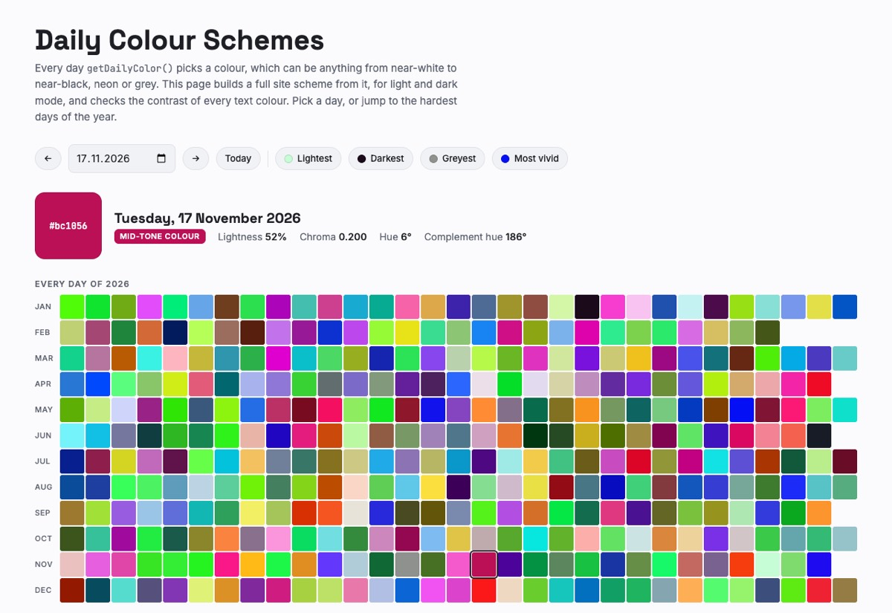

The rules we ended up with:

- **The header is today's exact colour**, with black or white text, whichever is easier to read.
- **Links and buttons use the same hue**, made lighter or darker only as much as they need to be to stay readable (a contrast of at least 4.5:1, which is what the WCAG accessibility guidelines ask for).
- **A second colour comes from the opposite side of the colour wheel**, for tags and little handwritten notes.
- **Backgrounds get a faint tint** of today's colour, so the whole page shifts, not just the links.
- **Light or dark mode follows your own setting.** The daily colour just decides the details.

We checked every single day of 2026 and 2027, in both light and dark mode, and every bit of text passed. The script runs before the page is drawn, so there's no flash of the wrong colour. Goodbye, DarkReader!

## Building it

I wanted to stay on Jekyll and GitHub Pages, so the site is still plain old Markdown files. The difference is that it now has its own theme, built on [klods](/klods/), my tiny component library. (It's a nice test of klods, too: anything that was awkward to do with it went onto the klods to-do list.)

Here's the first version:

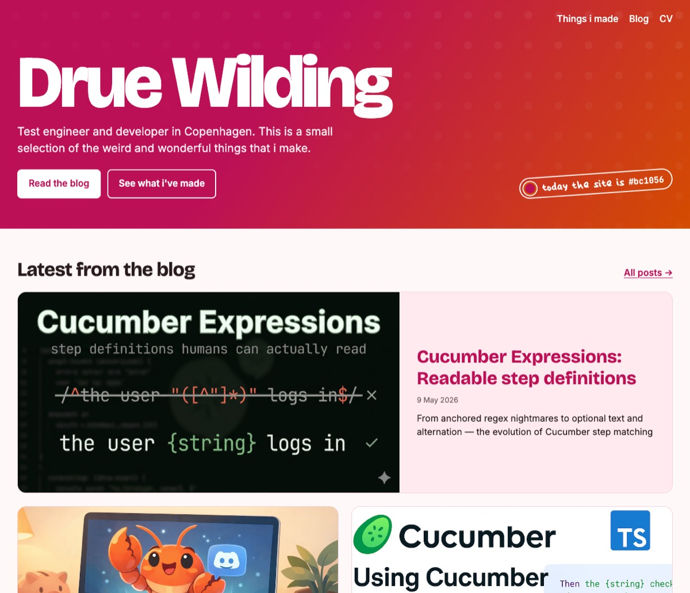

There's a big chunky heading, and blog cards with proper images. The "today the site is #bc1056" pill is in my own handwriting, because i [made my handwriting into a font](/handwriting/) a while ago and finally had a use for it.

## Tags and a Cucumber series

I write about a few quite different things, so the blog now has tags: Testing, AI, Copenhagen, Drones, Making and Creative coding. Seven of my posts are about Cucumber, so they're now a proper [series](/blog/cucumber/), numbered in order, with a little fan of their cover images on the blog page.

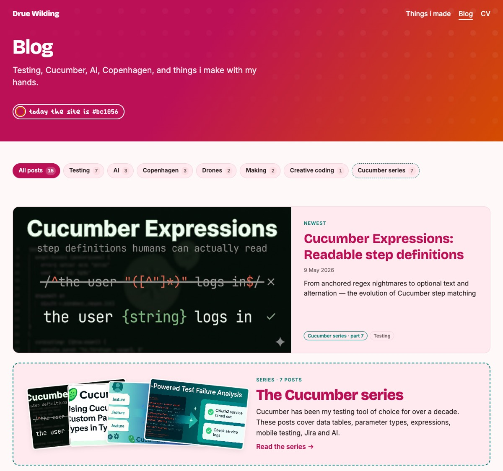

Each post in the series has a box at the top showing where you are, with a handwritten "you are here":

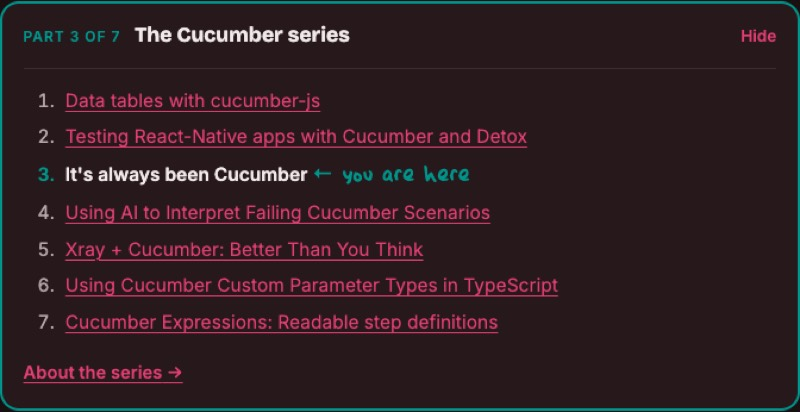

## Notes that hang off the edge

Some tiles in the portfolio have little handwritten notes on them. At first they sat politely inside the box:

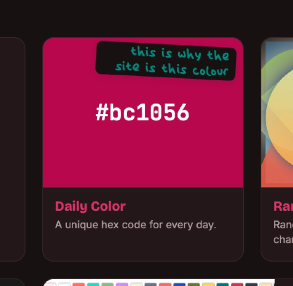

I wanted them to hang over the edge, like a sticky note someone slapped on:

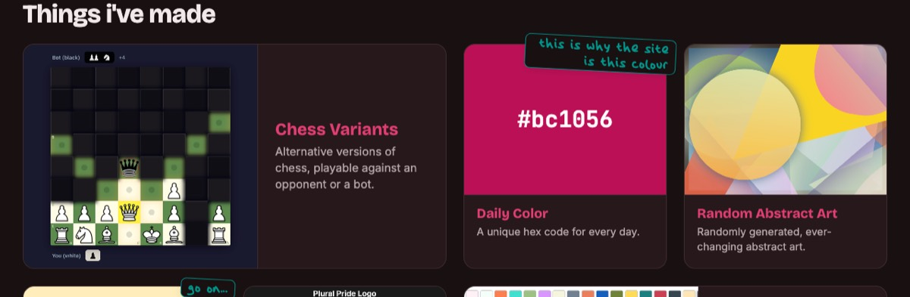

## A 404 page you can play

If you go somewhere that doesn't exist, you now end up in a tiny text adventure. You can look around, pick up a paint chip in today's colour, and walk through doors back to the rest of the site. If the address you typed looks a bit like one of my posts, a signpost appears and points you to it.

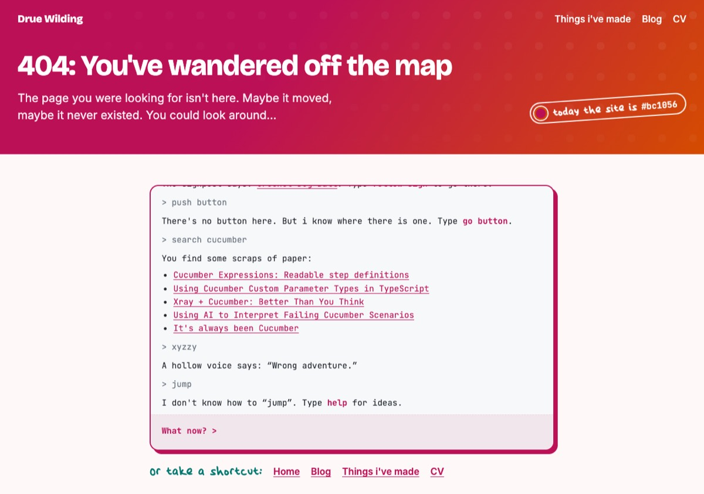

[Go and get lost](/this-page-does-not-exist/) to try it. (Old adventure game fans: try typing `xyzzy`.)

## Roll the dice

Then i thought: what if you don't like today's colour? So now there's a dice next to the pill. Click it and the whole site rolls a random colour, with the same rules as before, so it always stays readable.

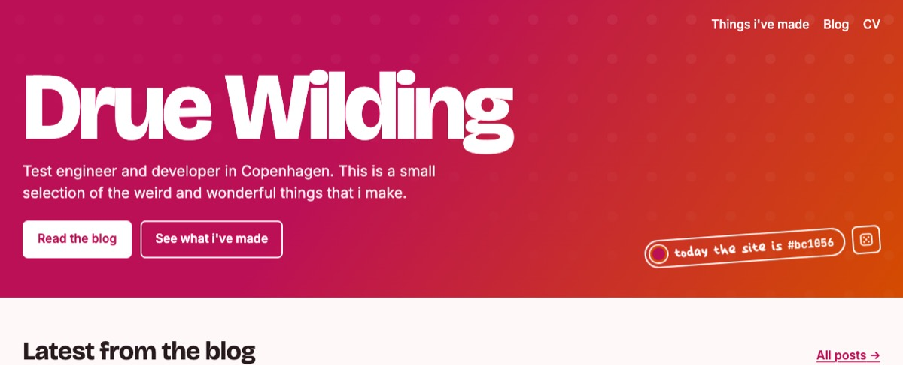

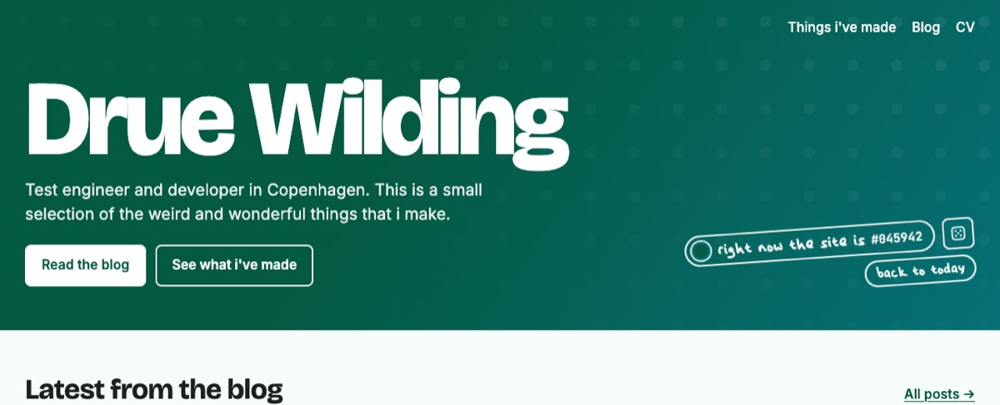

The pill changes from "today" to "right now", and a "back to today" button appears when you want the real colour back. The colour sticks around while you click from page to page, until you close the tab.

## Merlin's Castle, front and centre

The thing i'm proudest of is my remake of [Merlin's Castle](https://merlinscastle.net/), the BBC Micro adventure game from 1983, so it now gets the biggest spot on the homepage:

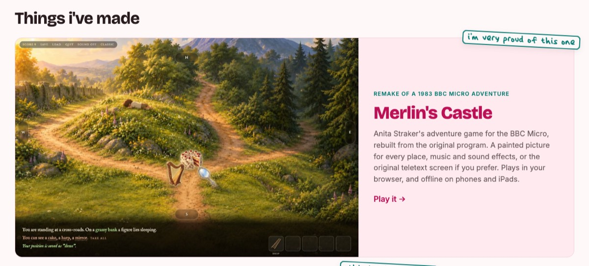

## Tidying up

Finally, we added the projects that had been missing (klods, Queermoji, KnitThis and Det Danske Alfabet) and sorted everything into groups, so the page feels less like a pile of things and more like a set of shelves:

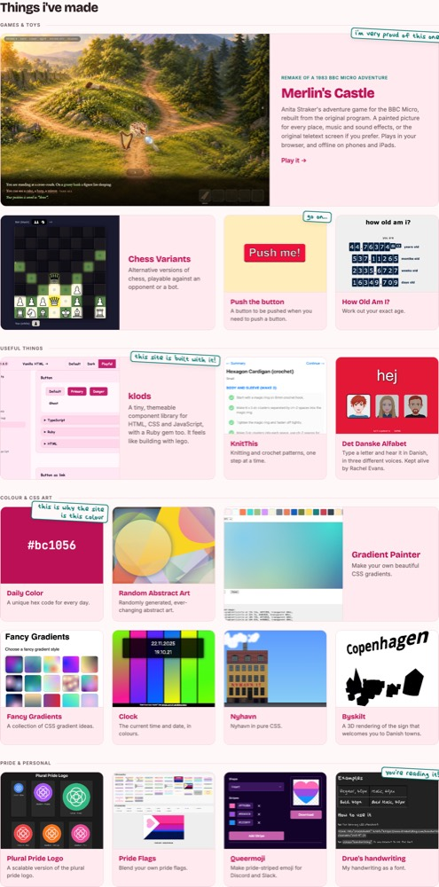

## What i learnt

- **Start with the idea, not the template.** Once the daily colour was settled, most of the other decisions made themselves.
- **Build a tool to test the idea.** Seeing every day of the year at once showed the problems with very pale and very dark days long before they reached the real site.
- **Say when something bothers you, even if it's tiny.** A note stuck inside its box, a link on the wrong words, a full stop at the end of a one-line description. Every one of them was a quick fix once i'd said it out loud.
- **Keep the fun bits.** Nobody _needs_ a dice button, or a text adventure on the 404 page, but those are the bits that make it feel like mine.

If you don't like today's colour, you know what to do. 🎲
