I make a lot of small websites. A font made from my handwriting, an emoji generator, chess variants i play with friends and family, a colour for every day of the year. Every time i started a new one, i'd find myself trying to remember how i'd done the layout last time. How did i centre that column? What spacing did i use? Why does the button look different on this site?

So in May i started building [klods](/klods/), my own little component library. _Klods_ is Danish for brick, like a Lego brick, and that's exactly how i wanted it to feel: small pieces that click together into something bigger.

The picture at the top of this post is five of my sites, all built with klods. They don't look the same, but they look like they belong together.

## Before klods

Here's what my sites looked like when i didn't bother to style them, like [Gradient Painter](/gradient-painter/) and [Fancy Gradients](/fancy-gradients/):

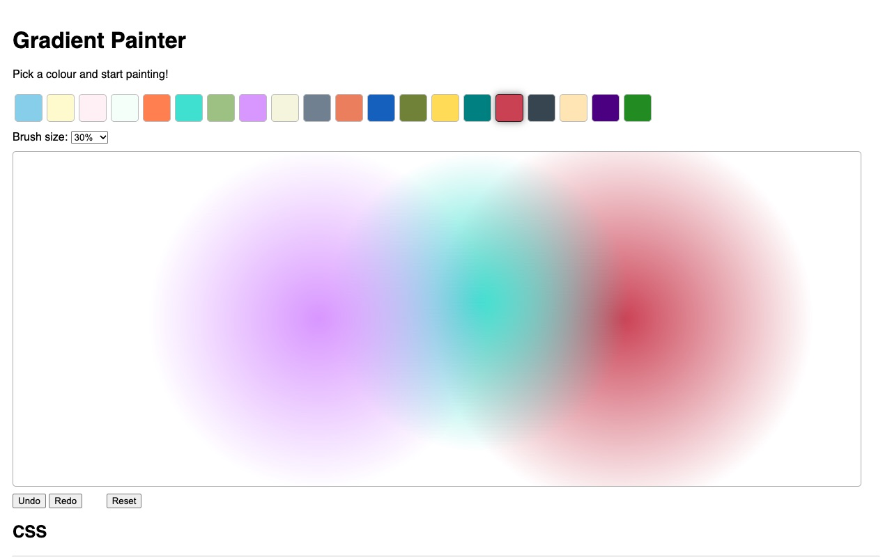

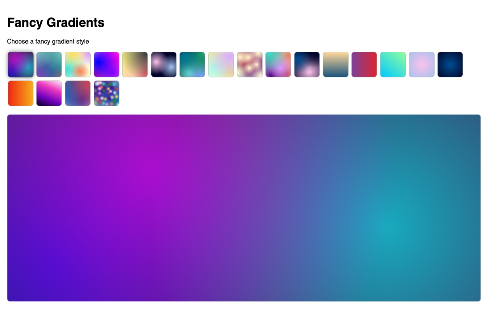

They work, and the gradients themselves are pretty, but everything around them is the browser's default. Default font, default buttons, default everything. (These two haven't been converted yet, which makes them very useful for a blog post.)

When i _did_ bother, every site got its own hand-made CSS, and it never quite matched the one before.

## What i wanted

I wanted three things:

- **Easy to get started.** Add one stylesheet, use a few class names, and it should already look good. No build step, no config, no choosing a colour palette before you can see anything.
- **Easy to customise.** Every colour, every space and every component can be changed from your own CSS. Nothing is locked away.
- **Something to call my own.** There are lots of great CSS frameworks out there, but sites built with them tend to look like sites built with them. I wanted my sites to look consistent with each other, but to look like _me_.

## Small bricks that click together

A klods page is made of a few layout pieces: a page, a header, a content column, a footer. Inside those go stacks and clusters (things on top of each other, things side by side), and inside _those_ go components: cards, buttons, badges, forms, tabs, lists, alerts and so on. There are 23 components at the moment.

Each piece only cares about itself. A card doesn't know it's inside a grid, and a button doesn't know it's inside a card. That means they snap together in any order, and they still look right.

Every class name follows the same pattern, so once you know one, you can guess the others. It's [BEM](https://getbem.com/), which stands for _block, element, modifier_:

- A **block** is a piece that stands on its own: `klods-card`
- An **element** is a part of a block, joined with two underscores: `klods-card__title`
- A **modifier** is a variation, joined with two dashes: `klods-button--primary`

So when you see `klods-card__footer`, you know it's the footer of a card, and when you see `klods-status--success`, you know it's a status in its success colour.

When i add a component to klods, it gets its CSS, a JavaScript builder, a Ruby builder in klods-ruby _and_ an example in the [docs](/klods/), all at once. The docs are the proof that a component works.

## Demo

You can use klods from plain HTML, from JavaScript or from Ruby. To show you, here's the same small card made all three ways: a game of chess, whose turn it is, and a button.

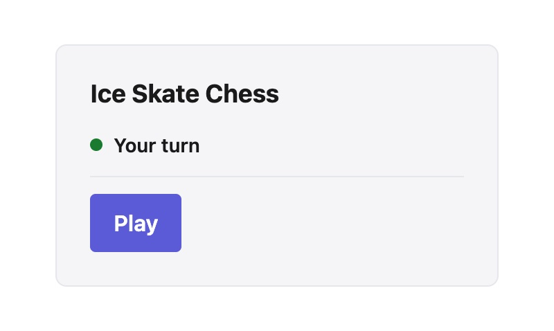

### Plain HTML

Add the stylesheet:

```html
<link rel="stylesheet" href="https://cdn.jsdelivr.net/npm/klods-css@2/dist/klods.min.css" />
```

Then write the HTML with klods class names:

```html
<div class="klods-card">
  <h3 class="klods-card__title">Ice Skate Chess</h3>
  <div class="klods-card__body">
    <span class="klods-status klods-status--success">Your turn</span>
  </div>
  <div class="klods-card__footer">
    <button type="button" class="klods-button klods-button--primary">Play</button>
  </div>
</div>
```

That's all you need. No JavaScript at all.

### JavaScript

If you'd rather not type out class names, [klods-js](https://www.npmjs.com/package/klods-js) has a builder for every component:

```bash
npm install klods-css klods-js
```

```javascript
import "klods-css";
import { button, card, cardBody, cardFooter, cardTitle, status } from "klods-js";

card([
  cardTitle("Ice Skate Chess"),
  cardBody(status({ variant: "success" }, "Your turn")),
  cardFooter(button({ variant: "primary" }, "Play")),
]).render(document.body);
```

The builders take the same shape everywhere: some options (if you need them) and then the children. Swap `.render(document.body)` for `.toString()` and you get the HTML as a string, which works on a server too.

### Ruby

[klods-ruby](https://rubygems.org/gems/klods-ruby) has the same builders, with Ruby-style names:

```ruby
# Gemfile
gem "klods-ruby"
```

```erb
<%= card([
  card_title("Ice Skate Chess"),
  card_body(status({ variant: "success" }, "Your turn")),
  card_footer(button({ variant: "primary" }, "Play"))
]) %>
```

In Rails, the builders are in every view straight away, with no imports. They work in HAML too.

All three make exactly the same HTML, character for character.

If you want somewhere to start, i have two templates with klods already set up:

- [express-server-template](https://github.com/druewilding/express-server-template) for Express and TypeScript
- [rails-server-template](https://github.com/druewilding/rails-server-template) for Ruby on Rails

## Add your own style

Out of the box, klods looks like this:

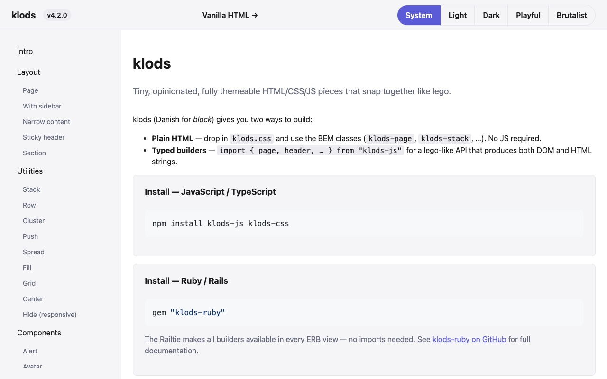

Clean and tidy, but fairly plain. The interesting part is how far you can push it. Here's my own site, which is built on exactly the same klods:

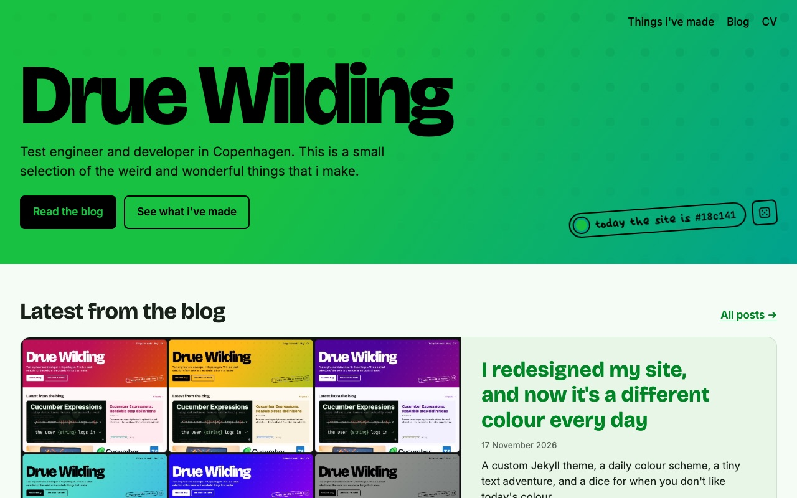

It has its own fonts, its own layout, and a different colour every day. All of klods' colours, spaces, fonts and sizes are CSS custom properties (tokens), so changing them is just a few lines of CSS:

```css
:root {
  --klods-font-sans: "Inter", sans-serif;
  --klods-font-size-base: 17px;
  --klods-color-accent: #18c141;
}
```

Every component then uses your values. The colours on my site are set like this too, except a little script works them out from today's [daily-color](/daily-color/) before the page is drawn.

Klods keeps all its CSS in [cascade layers](https://developer.mozilla.org/en-US/docs/Learn_web_development/Core/Styling_basics/Cascade_layers), so anything you write yourself wins without any fighting. I never need `!important`.

There's also a [live theme editor](/klods/#themes-builder) in the docs, if you'd like to play with the tokens and see what happens.

## Where it's already used

### Handwriting

The [handwriting](/handwriting/) site was the first one i converted, as a test. It's a small page for a font i made from my own handwriting, so it was a good place to check that klods could get out of the way of a very unusual font.

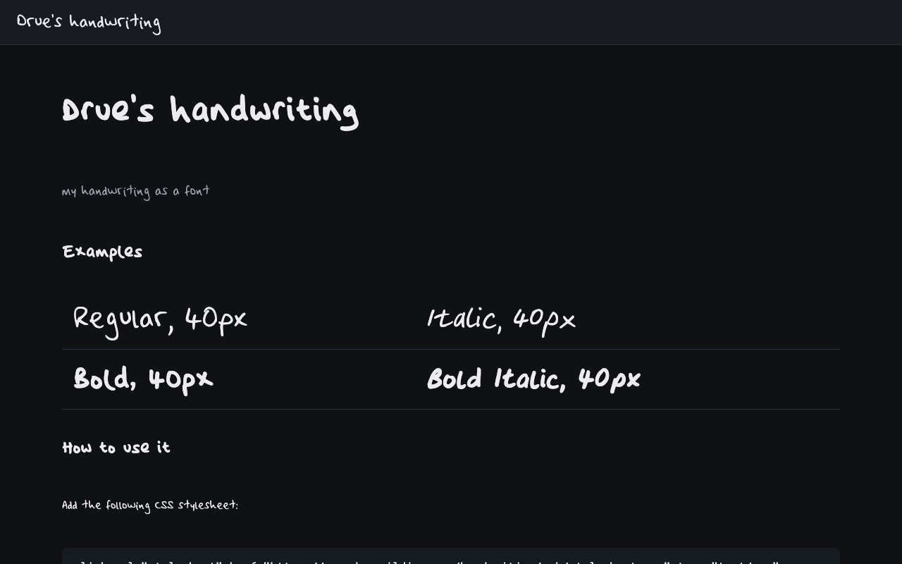

### Queermoji

[Queermoji](/queermoji/) makes pride-themed emojis for Discord and Slack. It was the second site i converted, and i used it to check that overriding the colours actually worked. It's very purple, and none of that purple is klods' default.

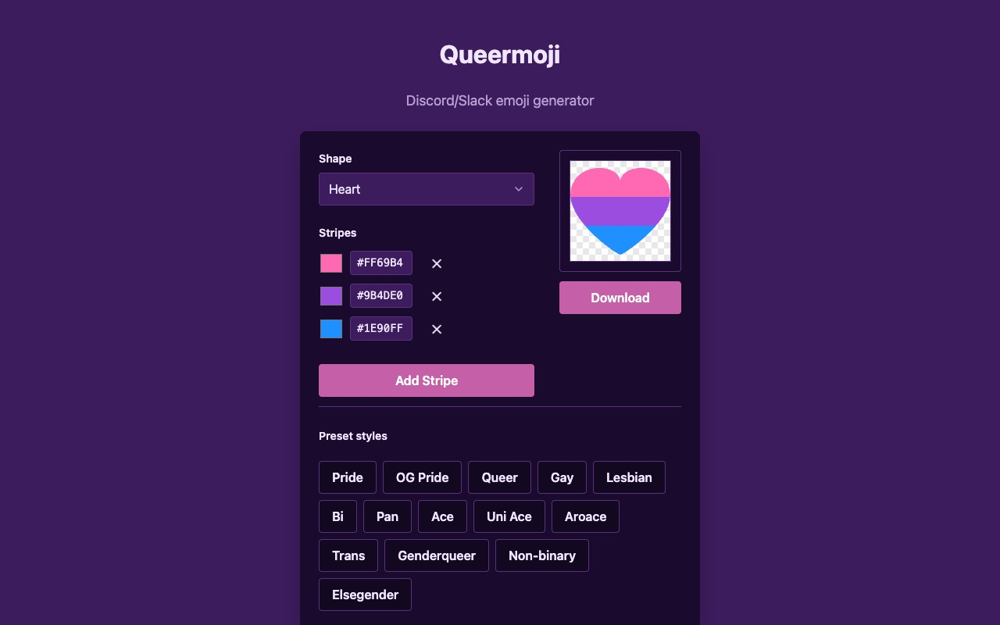

### This site

My [whole site](/) is a custom Jekyll theme on top of klods. It's the best example of how different klods can look when you lean on the tokens. I wrote all about [the redesign](/2026/11/17/redesigning-my-site.html) last week.

### Daily Color

The [Daily Color](/daily-color/) demo fills the screen with today's colour, and underneath it, palettes of the colours that go with it: complementary, triadic and so on. Click a colour and it's copied, ready to use.

The colour can be anything from pale yellow to nearly black, so the text and buttons on it have to change too. Inside that part of the page, klods' own tokens are set to black or white, whichever is easier to read on the day's colour:

```css
.hero {
  --klods-color-fg: var(--ink);
  --klods-button-fg: var(--ink);
  --klods-button-border: var(--ink);
}
```

The buttons are ordinary klods buttons, they just get their colours from `--ink`. Because the tokens are only changed inside `.hero`, the rest of the page keeps its normal colours.

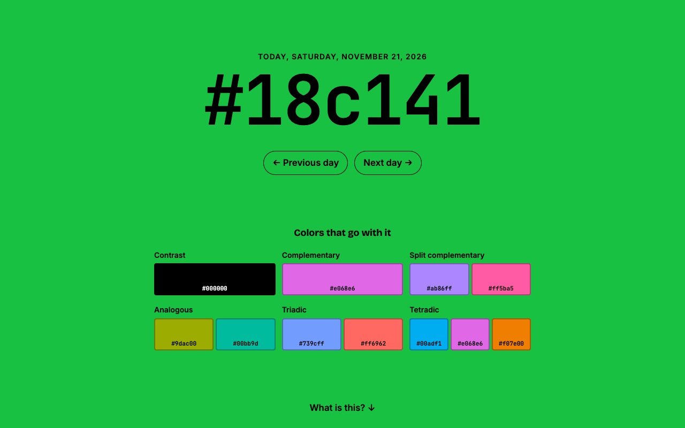

### Chess variants

[Chess variants](/chess/) is where it all came together. It's a site for playing alternative versions of chess, against a friend or against a bot. Some of them were invented by my sibling Luna, and i built the site so we could try them out together.

Here's what it looked like before klods:

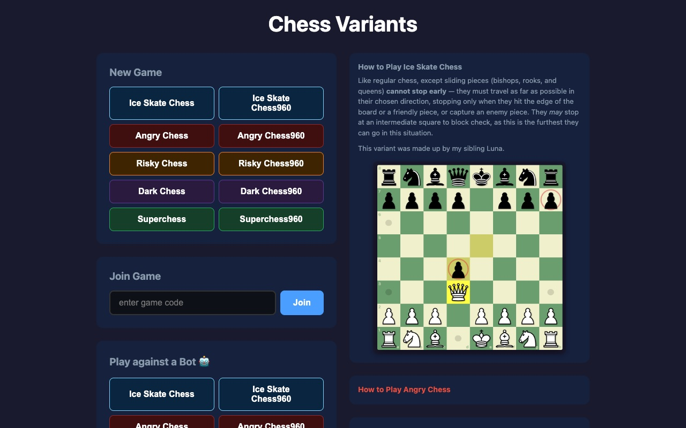

And here it is now:

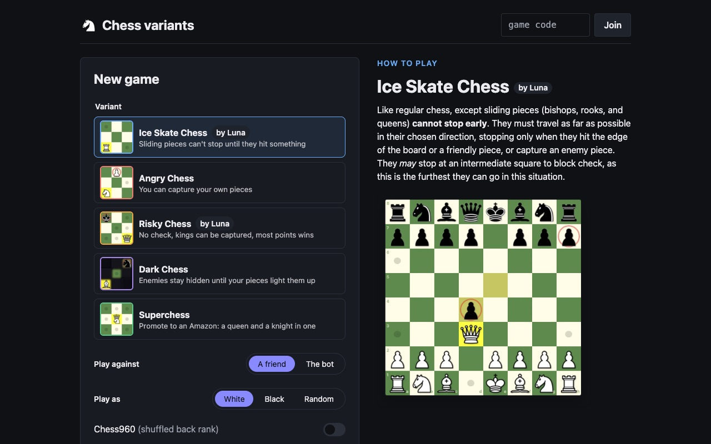

With klods, the spacing, padding, cards and buttons all match each other, on a phone as well as a big screen, without me having to think about it. Almost all of it is klods pieces: a card, a list, badges for "by Luna", segmented controls and a switch for Chess960. The chess board is the only part that's really custom.

## Improving klods by using it

This is my favourite part. Whenever i build something custom for one of my sites, i ask myself: _could this go into klods?_ If it could, i move it there, usually before i release the site that needed it. Then the site uses the klods version, and the custom code goes away.

That way klods grows out of real things i need, not things i guess someone might need one day. Here are three things that started that way.

### Light, dark or system theme

When i redesigned my site, i wanted it to follow your own light or dark mode setting. Until then, klods started out light, and you had to choose dark yourself.

So klods now follows the system setting by default. If your computer is in dark mode, a klods page is dark, with no JavaScript needed. If you'd rather choose, add `data-theme="light"` or `data-theme="dark"` to the page.

### Segmented control

The new chess form needed a way to choose between a few short options: a friend or the bot, white or black or random. I wanted them in a row, like one pill split into pieces.

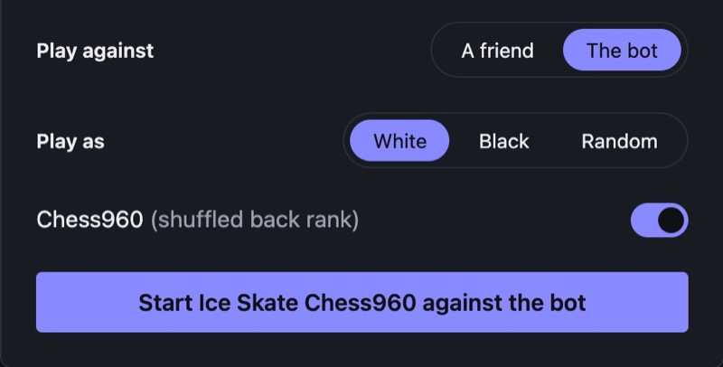

Under the hood they're ordinary radio buttons, so the arrow keys work, screen readers know what they are, and the choice is sent with the form.

### Status markers

The chess site also needed to show whose turn it is. I wanted a little coloured dot beside the words, the kind you see next to "Online" in a chat app. That became the new `klods-status` component:

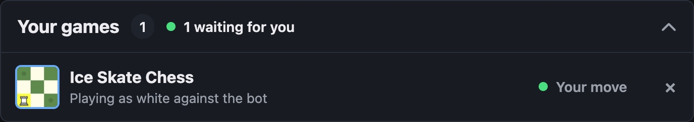

Klods offers a few standard colours:

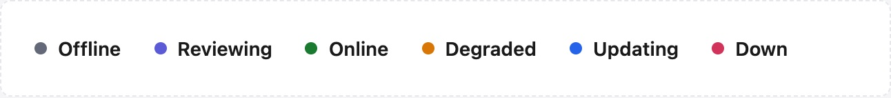

It can also pulse gently for something that's happening right now. The words always say the state on their own, so you're never relying on the colour of a dot.

## Try it

If you'd like to have a go:

- **Docs and examples:** [druewilding.com/klods](/klods/), including the live theme editor
- **Plain HTML demo:** [vanilla.html](/klods/vanilla.html), with no JavaScript at all
- **CSS:** [klods-css on npm](https://www.npmjs.com/package/klods-css), or the jsDelivr link above
- **JavaScript:** [klods-js on npm](https://www.npmjs.com/package/klods-js)
- **Ruby:** [klods-ruby on RubyGems](https://rubygems.org/gems/klods-ruby)
- **Source code:** [github.com/druewilding/klods](https://github.com/druewilding/klods)

I'd love ideas for what it should have next. A few things i've wondered about:

- **Ready-made page templates** to copy and paste, like a dashboard, a blog or a settings page
- **Web components**, so you could write `<klods-card>` instead of class names
- **A Tailwind preset**, so the same tokens work in a Tailwind project

Would you use any of those? Or is there something else you keep building by hand? Open an issue on [GitHub](https://github.com/druewilding/klods/issues), or tell me on Mastodon.

## Something to call my own

Klods is something i'm genuinely proud of. It's on npm and RubyGems, it has proper docs, and it's tested for accessibility in every theme.

The thing i like most, though, is opening one of my sites and knowing that every button, card and form on it is a brick i made myself. They look like they belong together, and they look like mine.

Now to convert [Gradient Painter](/gradient-painter/) and [Fancy Gradients](/fancy-gradients/)…
